# GeaStack demos

Showcase demos written once in TypeScript and run natively on very different
microcontroller boards, each laying itself out for the screen it is on.
Current deployment targets:

- **ESP32-S31 Mosaico** — 480x480
- **ESP32-S3 AMOLED 2.06"** — 410x502
The original **STM32F746G-Discovery** layout (480x272) is retained, but this
repository does not provide an STM32 deployment target.

Every demo is its own package under `apps/` with a `gea` manifest in its
`package.json`, like [geastack/examples](https://github.com/geastack/examples).
`shared/` holds fonts, styles and shared native modules. The 3D demos use
[`@geastack/gea3d`](https://github.com/geastack/gea3d), installed from npm
and licensed GPL-3.0-only.

| Demo | What it is |
|---|---|
| [bloom](apps/bloom) | Reaction-diffusion |
| [neon](apps/neon) | Synthwave 3D runner |
| [ripple](apps/ripple) | Multi-touch fluid |
| [reel](apps/reel) | Demoscene reel |
| [terra](apps/terra) | Voxel terrain flyover |
| [intro](apps/intro) | Animated GeaStack logo opener |
| [lantern](apps/lantern) | Paper-boat river journey on gea3d |
| [aviator](apps/aviator) | The Aviator, on gea3d |
| [orbit](apps/orbit) | 3D showcase on gea3d |
| [wander](apps/wander) | Travel inspiration with generated artwork |
| [nimbus](apps/nimbus) | Weather station over an illustrated town |
| [sonora](apps/sonora) | Smart speaker / music player |
| [ember](apps/ember) | Smart oven with guided cooking |
| [axel](apps/axel) | Camera-aware voice companion for Mosaico, with a dot matrix face |

The demos started life in the STM32F746G-Discovery gallery.

## On the STM32F746G-Discovery

Framebuffer grabs from the board (480x272), taken in the original gallery.

| Demo | Screens |
|---|---|
| [bloom](apps/bloom) | 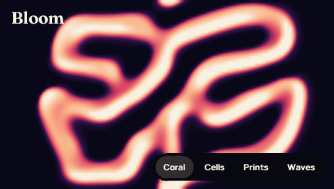 |
| [neon](apps/neon) | 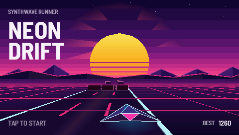 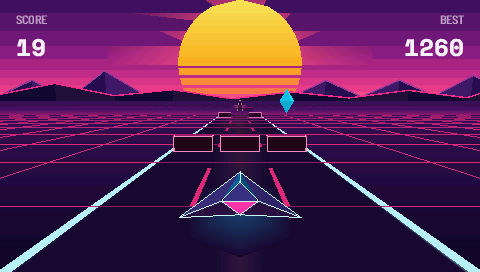 |
| [ripple](apps/ripple) | 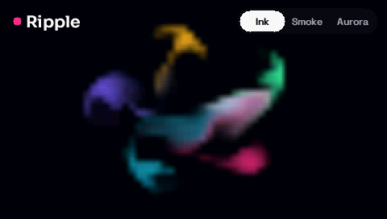 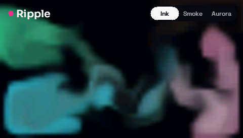 |
| [reel](apps/reel) | 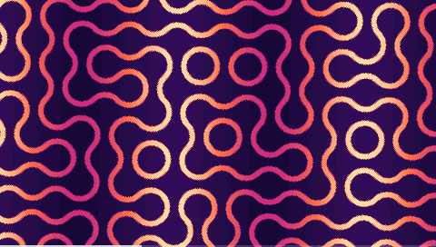 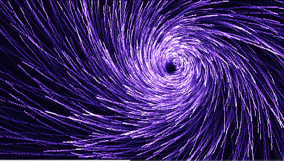 |
| [terra](apps/terra) | 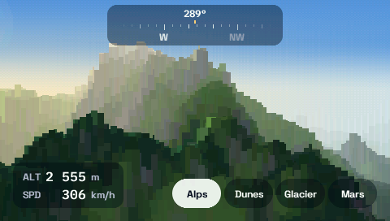 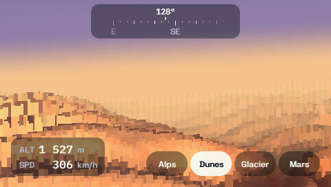 |
| [intro](apps/intro) | 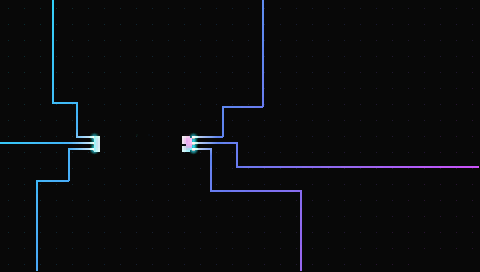 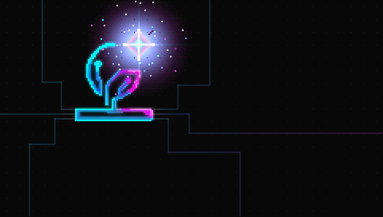 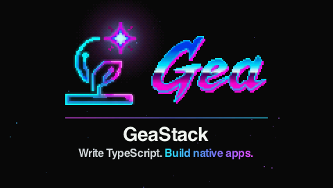 |
| [lantern](apps/lantern) | 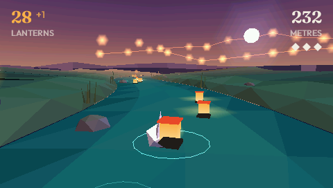 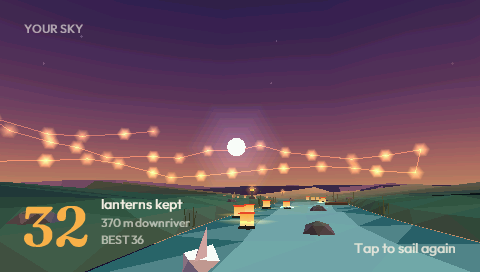 |
| [aviator](apps/aviator) | 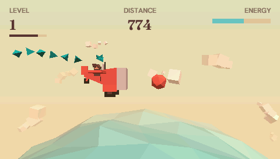 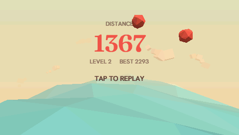 |
| [orbit](apps/orbit) | 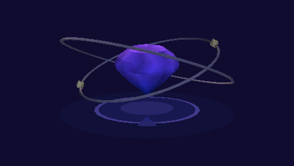 |
| [wander](apps/wander) | 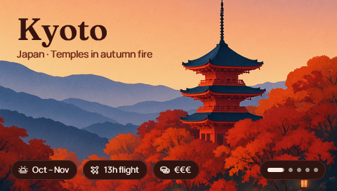 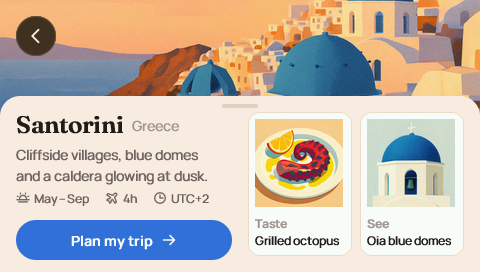 |
| [nimbus](apps/nimbus) | 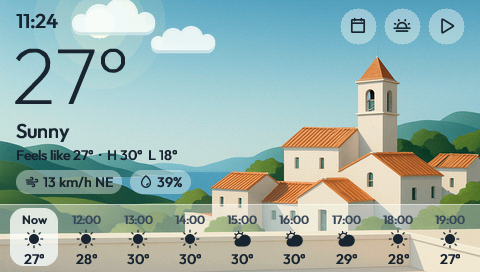 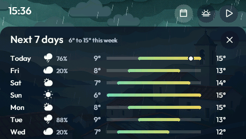 |
| [sonora](apps/sonora) | 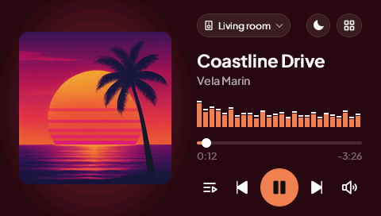 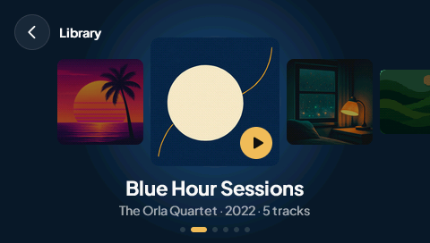 |
| [ember](apps/ember) | 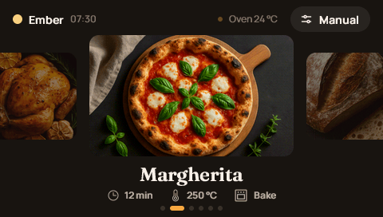 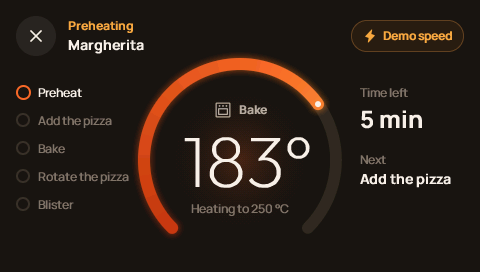 |

## Working here

Install the released dependencies from the repository root:

```sh
npm ci
npx --no-install gea setup
npx --no-install gea boards list
npx --no-install gea run --board mosaico --app lantern
npx --no-install gea screenshot --board mosaico
```

Register the board as `mosaico` during setup. Mosaico needs ESP-IDF 6.2-dev
with ESP32-S31 support. Each app's README includes toolchain installation,
board registration, build, flash, monitor and capture steps. Follow that
README before the first deployment; Axel also needs network and API credentials.

- [docs/PORTING.md](docs/PORTING.md): boards, responsive rules, build/flash flow.
- [docs/APP-GUIDE.md](docs/APP-GUIDE.md): engine rules, fast TypeScript, design bar.

## License

Copyright 2026 Geastack contributors. GPL-3.0-only; see [LICENSE](LICENSE).
Third-party dependencies, fonts and assets retain their respective licenses
and attribution notices.
